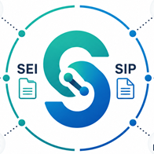

# @anpdgovbr/sei-sip-soap



Infraestrutura SOAP compartilhada pelos clientes `@anpdgovbr/sei-client` e
`@anpdgovbr/sip-client`.

Este pacote é publicado para resolver a dependência de runtime dos clientes. A
API é técnica e voltada a transporte SOAP, montagem de envelopes, parsing de
respostas e erros comuns. Consumidores finais normalmente devem usar os clientes
de domínio em vez de chamar este pacote diretamente.

## Uso

```ts
import { SoapError, callSoap } from "@anpdgovbr/sei-sip-soap"
```

## Compatibilidade

- Node.js 22 ou superior.
- ESM e CommonJS via `exports`.

## Alcance do transporte

A base não descobre operações pelo WSDL nem acrescenta capacidades ao servidor.
Não implementa retry, cache ou autorização de usuário final. SOAP Faults, erros
HTTP e timeout são representados por erros SOAP; outras falhas de rede ou
parsing podem propagar seu erro original. A aplicação deve tratar esses caminhos.

Veja [Integração e diagnóstico](../../doc/integracao-e-diagnostico.md) para
consistência de escritas, resultados parciais e limites de validação.
